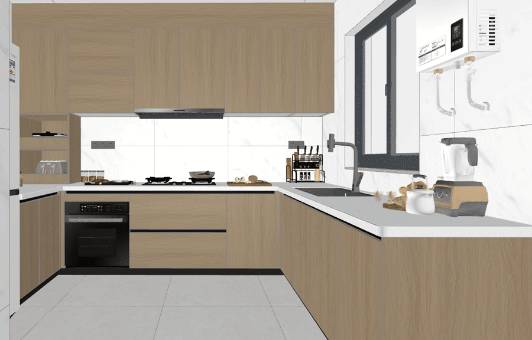

# dlss5-visual-enhancer

Pull one documented example from the DLSS5 visual enhancer, from the command line, and get back a
pair you can inspect: the input file, the output file, the SHA-256 of both, and a local compare page.



No account, no credits, no uploads. It asks the site's public catalog for one of its **cached**
examples — the same one a guest gets by clicking "run" on the page — and saves the result.

## What it is not

- Not NVIDIA DLSS 5, not a DLSS runtime, not a DLL, not a game integration. Nothing here installs,
  patches or replaces any NVIDIA file.
- Not a benchmark. One cached pair is one sample; it says nothing about speed.
- Not an uploader. Enhancing **your own** image is a different, signed-in flow on the site
  ([`/visual-enhancer`](https://www.dlss5nvidia.com/visual-enhancer), one credit per task); this
  script never sends a file of yours anywhere.

## Run it

Node 18 or newer, no dependencies, nothing to install:

```sh
node bin/enhance-example.mjs --sample sample1 --out ./out
open ./out/compare.html      # or: xdg-open ./out/compare.html
```

```
sample: sample1
host:   https://www.dlss5nvidia.com

catalog: 1791 ms · cached=true
input.jpg     0.15 MiB   906 ms  sha256:19d965fed4699633…
output.webp   0.13 MiB  1916 ms  sha256:229b802a24474dd6…

wrote /Users/you/out
open  /Users/you/out/compare.html
```

That is a real run, pasted as-is: three HTTP requests (catalog, input, output), no inference, no
credit spent. `compare.html` is one self-contained file — a slider over the two saved images plus
the hashes, so the pair can be checked later without trusting this README.

## The three samples, measured

| `--sample` | input | output | same frame? |
|---|---|---|---|
| `sample1` (kitchen render) | 1200×768 JPEG · 154,319 B | 1200×768 WebP · 134,222 B | **yes** — same camera, the slider is pixel-aligned |
| `sample2` (bedroom render) | 1670×1152 JPEG · 642,253 B | 1024×1024 WebP · 115,356 B | no — the output is a different geometry |
| `characterStyle` (game character) | 269×179 JPEG · 10,690 B | 1024×1024 WebP · 305,718 B | no — the input is a thumbnail, the output is square |

Only `sample1` is a frame-for-frame pair. With the other two the compare page still shows what
changed, but the images do not line up, so read them as a before and an after, not as an overlay.
We publish the numbers rather than crop the difference away.

## How it works

1. `POST /api/image-edit/samples` with `{"sample":"<id>"}` → the catalog record: prompt, input path,
   result path, `cached` flag.
2. `GET` the input path, `GET` the result path. Both must come back with an `image/*` content type,
   otherwise the script stops rather than saving an HTML error page as a picture.
3. Write `input.*`, `output.*` and `compare.html`, printing sizes, per-request time and hashes.

`--base` points the script at another host, which is what the tests use against a local fixture
server. Tests run offline:

```sh
npm test        # node --test · 3 tests · no network
```

## Boundaries

The output is a redraw of the input — materials, light and surface detail are re-synthesised. It is
not a recovery of missing detail, and it is not proof that a given picture will behave the same way
next time. Keep the hashes: they identify the exact bytes behind any claim made about this pair.

Not affiliated with NVIDIA. "DLSS" is NVIDIA's mark; this repository only describes work done with
our own pipeline.

MIT licensed — see [LICENSE](LICENSE).
